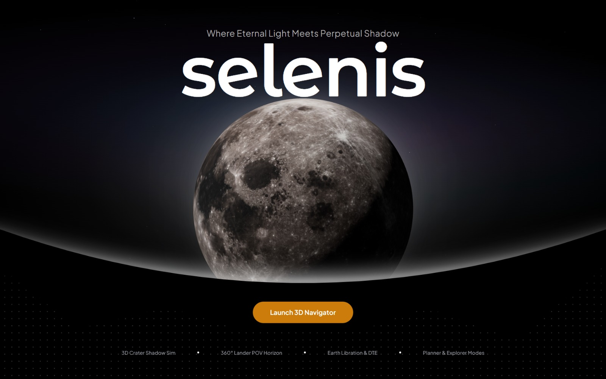
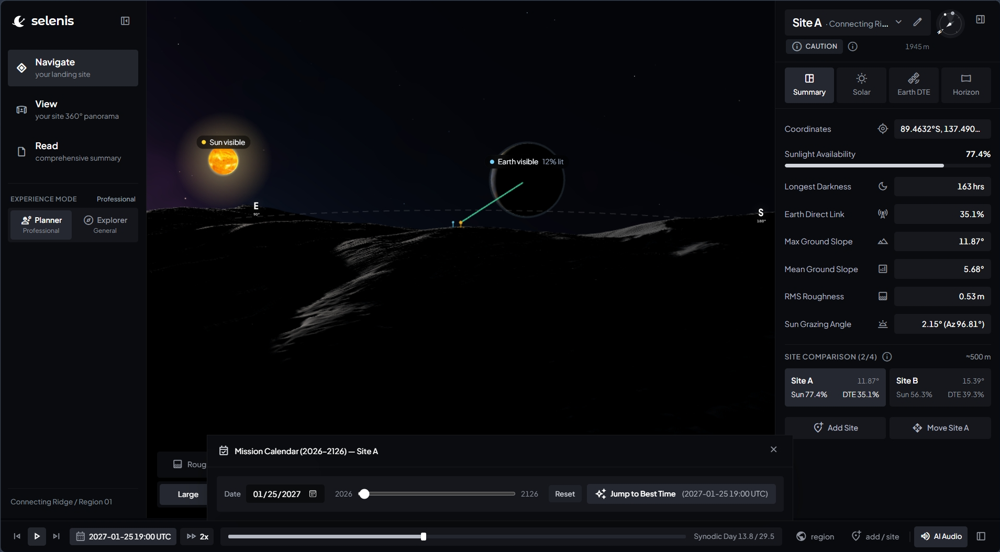

<p align="center">
  
</p>

<h1 align="center">SELENIS</h1>

<p align="center">
  <em>Where eternal light meets perpetual shadow.</em><br>
  Jelajahi medan, cahaya Matahari, dan garis pandang ke Bumi di Kutub Selatan Bulan.
</p>

<p align="center">
  
  
  
  
</p>

<p align="center">
  <strong><a href="https://selenis-timorex.netlify.app/">Kunjungi SELENIS</a></strong>
</p>

<p align="center">
  <a href="#mengapa-kutub-selatan-bulan">Mengapa Kutub Selatan?</a> &nbsp;&middot;&nbsp;
  <a href="#jelajahi-selenis">Fitur</a> &nbsp;&middot;&nbsp;
  <a href="#jalankan-di-komputer-anda">Mulai</a> &nbsp;&middot;&nbsp;
  <a href="#data-dan-referensi">Data dan referensi</a>
</p>

<p align="center">
  
</p>

<p align="center">
  <strong>Kenali medan. Bandingkan lokasi. Jelajahi Bulan.</strong><br>
  <sub>Sebuah demo navigator 3D untuk NASA Space Apps Challenge.</sub>
</p>

---

## Mengapa Kutub Selatan Bulan?

Di dekat Kutub Selatan Bulan, Matahari bergerak rendah di sepanjang cakrawala. Punggungan dan bibir kawah dapat menghalangi cahayanya, sementara bagian medan lain menerima cahaya lebih lama. Medan juga dapat menghalangi pandangan dari sebuah lokasi ke Bumi.

Kondisi tersebut membuat pemilihan lokasi pendaratan menjadi menarik untuk dijelajahi. **SELENIS** membantu memvisualisasikan hubungan antara topografi, pencahayaan, dan garis pandang geometris ke Bumi melalui aplikasi 3D di browser.

## Jelajahi SELENIS

<p align="center">
  
</p>

- **Jelajahi medan dalam 3D.** Lihat wilayah Connecting Ridge, Shackleton Rim, dan de Gerlache Rim.
- **Bandingkan lokasi.** Pilih atau tempatkan lokasi untuk melihat ringkasan pencahayaan, visibilitas Bumi, dan kemiringan.
- **Lihat cakrawala.** Amati arah Matahari dan Bumi serta profil horizon dari lokasi yang dipilih.
- **Ubah waktu.** Gunakan kontrol tanggal dan simulasi untuk menjelajahi perubahan posisi benda langit.
- **Pilih cara menjelajah.** Mode Planner menyajikan detail teknis; Explorer menyajikan informasi yang lebih ringkas.

> **Tentang hasilnya:** SELENIS adalah demo hackathon dan belum divalidasi untuk perencanaan misi atau penilaian keamanan pendaratan nyata. Perhitungan horizon terbatas pada cakupan DEM yang tersedia; garis pandang geometris ke Bumi tidak menjamin kualitas komunikasi, dan pencahayaan tidak menjamin daya yang dihasilkan.

## Bagaimana data digunakan?

SELENIS menggabungkan ephemeris dari **NASA JPL Horizons** dengan data topografi Bulan dari **LOLA/LROC**. Pipeline Python mengolah data tersebut menjadi JSON dan tekstur yang disertakan dalam repository. Aplikasi React kemudian menampilkannya sebagai medan, metrik, dan visualisasi di browser.

Waktu ditampilkan dalam **UTC**. Dataset ephemeris Site01 yang disertakan mencakup 14 November sampai 13 Desember 2026 dengan interval satu jam. Tanggal di luar rentang itu menggunakan proyeksi pendekatan aplikasi, bukan hasil baru Horizons; akurasinya belum divalidasi untuk keputusan misi. Bayangan WebGL merupakan visualisasi dan tidak menggantikan analisis horizon dari data medan.

---

## Jalankan di komputer Anda

Untuk mencoba website secara lokal, siapkan [Git](https://git-scm.com/), **Node.js 24.19.0** dengan npm, dan browser yang mendukung WebGL 2. Proyek ini tidak memerlukan Docker, API key, atau file `.env` untuk menjalankan frontend.

```bash
git clone https://github.com/kelekers/selenis.git
cd selenis
npm ci
npm run dev
```

Buka alamat **Local** yang ditampilkan di terminal, biasanya `http://127.0.0.1:5173/`, lalu pilih **Launch 3D Navigator**. Jika port tersebut sedang digunakan, Vite akan menampilkan alamat dengan port lain. Tekan `Ctrl+C` untuk menghentikan server.

Di PowerShell, jika `npm.ps1` diblokir, gunakan `npm.cmd ci` dan `npm.cmd run dev`. Dataset yang disertakan sudah cukup untuk mencoba aplikasi; pemrosesan ulang atau unduhan data NASA tidak diperlukan.

## Untuk pengembang

| Perintah | Kegunaan |
| --- | --- |
| `npm run dev` | Menjalankan server pengembangan lokal. |
| `npm test` | Menjalankan tes JavaScript. |
| `npm run lint` | Memeriksa kode frontend dengan ESLint. |
| `npm run data:check` | Memeriksa manifest dan integritas aset publik. |
| `npm run build` | Membuat hasil production di `dist/`. |
| `npm run preview` | Menampilkan hasil build secara lokal. |
| `npm run verify` | Menjalankan lint, tes, validasi data, dan build. |

Untuk bekerja dengan pipeline, instal [uv](https://docs.astral.sh/uv/getting-started/installation/) dan gunakan Python 3.13 seperti tercantum di `.python-version`:

```bash
uv sync --locked
uv run --locked python -m unittest discover -s data-pipeline -p "test_*.py"
uv run --locked python data-pipeline/build_site_telemetry.py --help
```

Membuat ulang data memerlukan input yang sesuai dan dapat menulis ulang aset publik. Periksa sumber, parameter, dan tujuan output terlebih dahulu. Detailnya tersedia dalam [kontrak data](docs/data-contract.md) dan [referensi teknis](docs/REFERENCES.md).

**Status pemeriksaan:** pada pemeriksaan terakhir, tes JavaScript dan build berhasil, tetapi `npm run verify` belum lolos karena error lint yang ada. `npm run data:check` juga melaporkan aset `textures/site01_heightmap2.webp` belum terdaftar. Jalankan ulang pemeriksaan sebelum menyimpulkan status versi terbaru.

## Pertanyaan umum

**Apakah harus menginstal Docker atau mengunduh data NASA terlebih dahulu?**

Tidak. Untuk menjalankan frontend, instal dependency Node.js lalu jalankan `npm run dev`. Data terkurasi yang digunakan demo tersedia di repository.

**Mengapa tampilan 3D tidak muncul?**

Periksa dukungan WebGL 2 dan akselerasi grafis browser. Aplikasi menyediakan tampilan cadangan jika WebGL 2 tidak tersedia.

**Apakah garis pandang Bumi berarti komunikasi pasti berhasil?**

Tidak. Garis pandang yang ditampilkan adalah evaluasi geometris, bukan perhitungan kualitas atau ketersediaan link radio secara lengkap.

**Bagaimana jika instalasi atau data gagal dimuat?**

Pastikan versi Node sesuai `.nvmrc`, jalankan perintah dari root repository, dan periksa pesan pada terminal atau tab Network browser. Untuk checksum, gunakan akhir baris LF dan ikuti [kontrak data](docs/data-contract.md).

## Data dan referensi

- [NASA JPL Horizons](https://ssd.jpl.nasa.gov/horizons/) — ephemeris Matahari dan Bumi.
- [LROC QuickMap](https://quickmap.lroc.asu.edu/) dan [NASA Moon Trek](https://trek.nasa.gov/moon/) — referensi visual dan topografi Bulan.
- [Canadian Space Agency: Moon Exploration](https://www.asc-csa.gc.ca/eng/astronomy/moon-exploration/) — referensi eksplorasi Bulan.
- [Referensi teknis dan atribusi model](docs/REFERENCES.md).

Ketentuan penggunaan setiap dataset dan model mengikuti sumbernya. Lisensi kode proyek belum ditetapkan.
